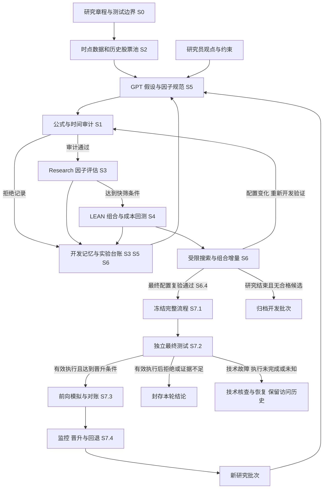

# BBAG 完整开发路线与阶段目标

更新时间：2026 年 10 月 31 日。

本路线覆盖前文的因子挖掘业务流程，以及 Codex 开发和 GPT Work 验收流程。开发沿用 0 至 7 的八个主阶段，以 S0 至 S7 标识；复杂阶段进一步拆分可独立交付的子里程碑。

先实现一条人工定义因子的完整计算与交易验证链路，再接入 GPT 自动生成和受限探索。阶段验收检查系统实现与证据质量；研究结果可以是支持晋升、拒绝候选或证据不足。

## 业务流程与开发阶段对应关系

图中的研究反馈仅使用开发区数据。最终测试的原始数据、指标、图表、排名、解释、评审意见和调参建议均保存在独立审计区，不进入开发记忆、候选生成提示词、检索索引和开发用导出。根据最终测试生成的摘要继承同样的隔离规则。负责人按预登记协议查看结论；一旦据此修改或选择方案，相关区间须登记为已用于研究决策。后续独立评估需要尚未用于研究决策的新数据。

主图中的前向模拟是候选的经济验证路径。固定基准的工程演练使用独立测试标识，不经过候选经济晋升，也不改变被拒或证据不足候选的状态。完整路径的输入、预期行为和证据要求见 [流程路径验收用例](FLOW_ACCEPTANCE.md)。

| 图示节点 | 开发阶段 | 必须提供的能力 |
|---|---|---|
| 研究章程和封存测试集 | S0 设计，S2 执行 | 固定研究目的、时间分区、访问边界、预算与晋升规则 |
| 时点数据和历史股票池 | S2 | 使用历史当时可知的字段和成分，保留来源与版本 |
| 假设和因子规范 | S5 | 从研究约束和允许的知识生成可验证的经济假设及结构化候选 |
| 公式与计算审计 | S1，S5 接入 | 解析受限表达式，检查类型、窗口、复杂度与时间因果 |
| Research 因子检验 | S3 | 计算预测、分层、暴露、稳定性与初步成本指标 |
| LEAN 策略回测 | S4 | 按实际事件顺序验证持仓、成交、成本和风险 |
| 开发记忆反馈 | S3 保存，S5 使用，S6 管理 | 成功与失败都有记录，反馈可用于下一轮开发 |
| 因子与模型联合优化 | S6 | 固定模型筛因子、固定因子筛模型，再有限交替，最终配置重新完成开发验证 |
| 冻结和独立测试 | S7.1 至 S7.2 | 冻结完整流程，隔离执行最终评估并保存结论 |
| 前向模拟和持续维护 | S7.3 至 S7.4 | 记录新增数据表现，对账、监控、切换版本与回退 |

## 首版范围

首版按单一市场、单一频率、一个数据适配器和一套固定评估协议建设。延续前文示例，以美股日频价量截面因子作为初始方向。S0 固定这些事项的配置接口和待确定清单；具体股票池、数据权限、预测期和交易规则由项目负责人在正式研究前确认并版本化预登记。DRAFT 样例不代表参数已批准。

预测期与调仓期分别配置，标签必须与实际入场、退出时点一致。基本面、文本数据、多市场和多资产在核心链路稳定后扩展。

首版研发包括假设生成、因子计算、Research、LEAN、搜索、最终评估和模拟运行。真实资金自动部署作为后续单独范围，不计入 S0 至 S7 的完成条件。

## 阶段总览与依赖

| 阶段 | 核心开发目标 | 主要依赖 | 退出条件 |
|---|---|---|---|
| S0 | 固定研究协议与工程接口 | 无 | 配置、接口、阶段规范和最小运行入口可验证 |
| S1 | 实现确定性计算与审计 | S0 | 手算答案、因果计算和输入异常测试通过 |
| S2 | 实现时点数据与平台适配 | S0，S1 数据接口 | 真实小样本可追溯，测试边界与任务状态正确 |
| S3 | 实现单因子 Research | S1，S2 | 固定因子报告可重复、可独立复算 |
| S4 | 实现 LEAN 交易验证 | S3 | Research 与 LEAN 一致，订单、成本和风险可验证 |
| S5 | 实现 GPT 生成和反馈 | S0 至 S4 | 至少完成一轮有预算的真实候选反馈闭环 |
| S6 | 实现受限搜索与组合 | S5 | 搜索完整留痕，最终配置的开发证据匹配，增量可归因且能停止 |
| S7 | 实现独立测试与前向运行 | S6.4 | 冻结和分支判定正确，候选晋升受控，前向功能及恢复可验证 |

依赖是阶段晋升条件。公共接口固定后，独立实现任务可以并行；集成版本按上述顺序验收。

## S0 研究协议与工程骨架

**开发目标：**让研究要求、模块接口、数据边界和验收规则成为可读取、可校验的项目配置。

**S0.1 研究协议**

- 固定目标市场、资产、频率、历史股票池规则、基准、预测标签与调仓规则的接口；尚未批准的取值登记为待确定事项，由项目负责人在正式研究前确认。
- 定义数据可用、信号形成、下单、最早成交和退出的时间关系。
- 划分开发区、预留最终测试区及冻结后新增数据，明确每区用途和结果披露规则。
- 定义成本、风险约束、研究配置预算、运行费用预算、停止条件和晋升条件的配置项；正式取值须经项目负责人确认后预登记，S0 演示值保持 DRAFT。
- 区分工程通过、平台集成通过和因子经济证据三个维度，并为评估任务单独记录执行有效性。
- 预登记冻结资格、候选前向晋升、拒绝归档、证据不足归档和技术异常处理规则；完整路径用例纳入阶段验收。

**S0.2 工程骨架**

- 建立本地版本管理、最小 Python 项目、依赖记录和可重复运行入口。
- 定义 DataSpec、FactorSpec、LabelSpec、ExecutionSpec、EvaluationSpec、ExperimentRecord 和 ReleaseManifest 的标准接口；这些名称为本项目自定义契约。
- 定义实验编号、候选谱系、代码与配置哈希、数据来源和任务编号的关联方式。
- 将持久项目规则写入 AGENTS.md，并为各阶段保存可执行的验收清单。
- 建立测试数据、运行输出、模型文件和审核材料的存放约定，凭据通过独立配置提供。

**交付物：**工程骨架、接口规范、样例配置、研究协议、阶段任务清单、最小运行入口与 S0 审核包。

**验收条件：**样例配置可校验并生成完整实验清单；缺必填项或时间顺序冲突时有明确错误；输入输出和版本可关联；最终测试隔离方案能落实到后续接口。

**范围边界：**本阶段验证规范和工程入口，因子数值实现进入 S1，平台调用进入 S2。

## S1 确定性因子引擎与公式审计

**开发目标：**让相同数据与配置产生一致的因子、标签和审计结论。

- 实现最小算子集，明确延迟、收益、滚动统计、时间序列排名与截面排名的含义。
- 用受限表达式和语法树解析公式，校验字段、类型、窗口、自由参数及最大回看期。
- 将特征计算与未来标签计算分离，限定各自可访问的数据范围。
- 固定缺失值、常数、窗口不足、除零、无穷值和极端值处理规则。
- 用共享计算函数实现少量手写基准因子，建立批量与逐期计算接口。
- 为标签记录入场、退出时点及标签成熟时间，后续训练只读取已经成熟的标签。

**交付物：**算子库、表达式解析和审计器、因子与标签服务、手算样本、独立标准答案及 S1 审核包。

**验收条件：**手算样本一致；修改未来数据不改变过去因子；完整数据与截断数据在相同可用时点的结果一致；非法未来引用被拒绝；批量与逐期结果在预登记容差内一致。

**范围边界：**先实现足以验证核心链路的算子，不追求一次覆盖所有因子语言和数据类型。

## S2 QuantConnect 适配与时点数据

**开发目标：**把真实平台数据和任务结果转换为有来源、时间、版本及边界控制的统一接口。

**S2.1 平台与任务接口**

- 接入可用的项目、数据、研究、编译、回测和结果工具，能力以连接器实际接口为准。
- 使用平台返回的真实项目和任务编号，保存提交配置、版本及原始返回值。
- 区分任务已接受、编译完成、运行完成、结果可用及评估完成。
- 处理失败、超时、重复完成消息和重启恢复；提交结果不确定时先核实既有任务，避免盲目重复提交。
- 分别记录不同研究配置数量与实际执行次数，缓存复用须核对数据、代码和配置版本。

**S2.2 数据和访问边界**

- 接入小规模真实价量数据，按历史日期重建股票池和流动性筛选。
- 维护证券身份、更名、退市和公司行动；明确价格、成交量、成交额及收益的复权口径。
- 保存数据覆盖、缺失、异常、陈旧程度、交易日历和时区规则。
- 在适配器或受控服务中执行日期访问检查，开发流程不能查询封存测试区。
- 为数据生成可复现的版本元数据，支持分批取数和缓存；数据文件交付遵循数据许可范围。

**交付物：**平台适配器、持久任务记录、标准数据面板、历史股票池、数据质量报告、访问边界测试及 S2 审核包。

**验收条件：**原始值到标准字段可抽样追溯；历史股票池包含当时应有成员；公司行动口径正确；越界查询被阻止；小规模真实平台测试完成；异常与恢复测试保留实际证据。

**扩展目标：**基本面增加报告期、披露时间和修订版本；文本数据增加原始快照、实际可用时间、模型与提示词版本。对供应商时点近似规则单独登记并测试。

## S3 单因子 Research 评估

**开发目标：**对固定因子产生统一、可重复、可独立复算的研究结论。

- 使用 S1 共享计算模块和 S2 数据接口，在 QuantConnect Research 中运行固定基准因子。
- 按入场和退出规则计算目标收益与超额收益，预处理参数仅使用允许的数据拟合。
- 实现按日期切分的滚动训练与验证，处理跨边界标签和标签成熟约束。
- 计算覆盖、区分度、IC、RankIC、分层收益、暴露、换手、相关性及其分时期表现。
- 对重叠标签与时间相关采用匹配的统计协议，记录样本量和不确定性。
- 保存基准、对照及失败结果；从本阶段开始维护正式实验台账。
- 将常规因子报告和可交易策略报告区分，Research 结果不替代 LEAN 交易验证。

**交付物：**研究执行入口、固定基准、标准评估器、滚动验证配置、因子报告、原始评估序列及 S3 审核包。

**验收条件：**同版本重复结果一致；小样本指标可独立复算；标签、切分和预处理没有越界；随机及打乱标签等对照按既定统计协议解释；报告结论可追溯到原始序列。

**范围边界：**不以必须获得显著正 IC 作为工程完成条件。

## S4 LEAN 可交易验证闭环

**开发目标：**使一条固定因子在真实数据上完成数据、信号、目标持仓、订单、成交和净值链路。

- 在 LEAN 中复用 S1 因子计算逻辑，明确预热、数据到达与事件处理顺序。
- 实现股票池、信号、组合构建、风险控制、执行和退出规则。
- 明确预测期与调仓期，处理重叠持仓、资金占用、未成交及退出时仍不可交易的情况。
- 显式配置费用、点差、滑点、成交限制及适用的融资和借券成本，核对成本计算口径。
- 实现单股、行业、风格、杠杆和流动性约束的可验证执行。
- 抽样对齐 Research 与 LEAN 的字段、因子值、信号及目标持仓。
- 保存订单和成交记录，支持独立重算收益、费用和净值，并开展延迟和成本压力测试。

**交付物：**固定基准 LEAN 算法、交易配置、计算对账报告、订单与净值记录、压力测试及 S4 审核包。

**验收条件：**收盘后形成的信号不无条件按同日收盘成交；共享因子结果一致；费用、成交和风险限制实际生效；净值可复算；完成一条人工因子的真实平台全流程运行。

**里程碑：**基础量化研究系统形成，随后再接入自动候选生成。

## S5 GPT 假设生成与开发反馈

**开发目标：**让 GPT 生成有限、可验证的候选，接受真实环境反馈并保留研究记忆。

**S5.1 假设与规范生成**

- 读取研究章程、字段字典、可用算子和允许使用的文献及开发记忆。
- 支持研究员输入投资观点、约束和评审反馈，交互提案与自主提案进入同一规范和评估流程。
- 输出经济机制、预期方向、预测期限、适用环境、竞争解释和失效条件。
- 生成结构化 FactorSpec，并记录文献、模型、提示词和父候选。
- 将结构校验、公式审计、语义审查和数值评估分开执行。

**S5.2 工具编排与错误处理**

- 依次调用审计、Research 和必要的 LEAN 验证，使用平台结果生成反馈。
- 限制候选数量、修复次数、运行时间和费用，累计消耗由程序记账。
- 复用 S2 持久任务状态，支持失败恢复和结果去重，阻止将任务接受误报为完成。
- 对无效字段、非法算子、过深公式、未来信息和越界请求产生明确拒绝记录。
- 在中断、缺数据或无权限时输出可恢复状态与未验证事项。

**S5.3 研究记忆与完整迭代**

- 将成功、失败、拒绝、实现修复及其原因保存为可检索记录。
- 让下一轮检索明确相关的既有结果，保留候选修改谱系。
- 区分实现修复与经济逻辑变化，后者登记新候选配置。
- 完成至少一次生成、评估、归档、检索和下一轮提案的闭环。

**交付物：**GPT 接口、规范化提案、编排器、预算控制、研究记忆、恢复记录、完整迭代及 S5 审核包。

**验收条件：**违规请求被程序拦截；数值来源真实；预算和修复上限生效；失败经验可检索；重复结果不重复计入；首轮结果能够影响下一轮提案。全部候选被拒绝仍可完成工程验收。

**里程碑：**首版自动因子研究系统形成。自改进在此表现为记忆、候选与代码迭代，不包含自动训练 GPT 权重。

## S6 受限探索与因子模型联合研究

**开发目标：**在固定预算中选择有增量价值的候选，并使因子、模型和交易规则变化可以归因。

**S6.1 搜索和正则约束**

- 对表达式进行规范化并比较结构相似度、因子值绝对相关及因子收益相关。
- 同时约束复杂度、自由参数和假设一致性，保留少量不同取舍的候选。
- 将窗口、方向、标签、预处理、股票池、模型和组合规则变化登记为研究配置。
- 预登记预算、停止条件及探索策略，避免根据最终测试表现继续搜索。

**S6.2 因子组合增量**

- 先固定简单模型或组合规则，比较基准、基准加候选及删除候选后的结果。
- 对比时固定日期、股票池、成本、风险及评价口径。
- 检查组合增量、暴露来源、换手、稳定性和成本压力表现。

**S6.3 模型优化与统计诊断**

- 固定因子集后评估有限模型与参数，再按统一预算执行少量交替优化。
- 将模型训练、特征顺序、清洗器、成熟标签和训练截止时间纳入版本记录。
- 保存完整候选收益序列及选择过程，按预登记协议做多重尝试与过拟合诊断。
- 如使用 DSR 或 PBO，记录有效试验数量、候选相关性和计算假设；诊断结果不作为反复拟合的独立搜索目标。
- 达到预算、停止条件或资源边界时形成明确的研究结束状态。

**S6.4 最终配置开发复验**

- 为准备冻结的候选确定唯一配置清单，关联源码、数据口径、股票池、公式与算子、预处理、特征顺序、标签与评价协议、模型训练、组合、风险、交易和成本规则。
- S6 改变相关配置后，使受影响的旧证据失效，并返回公式与时间审计、Research 和 LEAN 开发验证；未受影响且版本匹配的证据可以复用。
- 最终组合必须具有自身的含成本 LEAN 开发证据及所需对账和压力测试。单个因子分别通过回测，不能替代组合后的资金、成交、成本和风险验证。
- 校验拟冻结清单与开发证据的代码、配置、数据版本及任务编号一致；任务已接受、运行中、失败或必要证据缺失均不构成复验通过。
- 固定模型核对模型工件和清洗器；滚动训练策略核对训练规则、参数、特征处理与每个窗口的合法模型版本及训练截止时间，禁止用最终训练的权重或清洗器回灌历史。
- 复验消耗计入既定预算。预算不足而证据未齐时保持未验证，不能使用最终测试代替开发验证。

**交付物：**搜索协议、完整候选谱系、组合与消融报告、有限模型比较、统计诊断、候选清单、最终配置开发复验记录和停止记录。

**验收条件：**所有配置分支可追溯；取负号不能绕过冗余检查；因子与模型改动的增量能分别说明；没有跨区选择；相同版本可重放；预算耗尽时正常停止。进入 S7.1 的每个候选均须通过 S6.4，具有与拟冻结配置匹配的审计、Research、LEAN 和必要对账证据；无合格候选时归档本轮研究，不强制冻结候选。

**里程碑：**形成有预算的完整自动因子挖掘能力。

## S7 冻结评估与前向运行维护

**开发目标：**把开发结论转化为固定版本的独立证据，并使运行过程具备对账、监控和恢复能力。

**S7.1 冻结发布包**

- 核验 S6.4 的开发复验记录和最终配置，缺失或版本不匹配时阻止冻结及最终测试。
- 冻结公式、字段、特征顺序、预处理、训练规则、参数选择方法、股票池、成本、风险和交易规则。固定模型冻结工件和清洗器；滚动模型冻结初始工件及后续更新的准入规则，逐次保存合法新工件的谱系和时间边界。
- 保存代码、配置、数据元数据、环境、模型及实验台账的版本关系。
- 校验模型在历史回测时已经训练完成且训练数据截至当时。
- 给每个发布包分配不可变标识，审核结论绑定该标识。

**S7.2 独立最终测试**

- 由受控执行者按预登记协议运行选定的冻结流程及固定基准。
- 只开放所需权限，记录测试访问与结果披露历史。
- 分别形成工程正确性、平台集成和经济证据结论。
- 有效执行后，达到预登记晋升条件记为 SUPPORT，未达到记为 REJECT，有效样本或统计证据不足记为 INCONCLUSIVE。
- REJECT 和 INCONCLUSIVE 均归档本轮结论，该候选不得进入前向经济验证或自动改公式重试；以后重新研究建立新记录，并重新判定可用的独立数据。
- 数据缺失、代码异常、任务未完成或状态未知、版本错配时，执行有效性记为 ERROR、INCOMPLETE 或 UNKNOWN，经济结论保持 NOT_EVALUATED。先核查或按协议修复，不将技术故障解释为因子无效或统计证据不足。
- 最终审计内容及其派生解释和建议保持隔离。业务编排器只接收发布包编号、任务编号、执行有效性和允许动作等最小控制信息，这些信息不进入研究记忆。

**S7.3 前向模拟与对账**

- 候选进入前向经济验证前，须确认最终评估执行有效、相关必需工程与平台验收项通过、经济结论为 SUPPORT，并且部署配置遵循该冻结发布包。固定模型核对同一工件和清洗器；滚动模型只允许按冻结训练规则合法生成、通过就绪校验的新工件，记录父版本、训练截止时间和实际启用时间，禁止使用未来数据。
- 按冻结规则生成的合法滚动模型更新不改变研究配置；训练规则、参数选择或特征处理发生实质变化时，建立新发布版本并返回受影响的开发复验，不能借工件更新绕过晋升规则。
- 候选运行以 purpose = ECONOMIC_VALIDATION 和候选发布包编号登记，记录冻结后新增数据、信号、目标持仓、订单和模拟成交。
- 模拟、监控和回退功能可以使用预先固定的基准或测试夹具演练，登记 purpose = ENGINEERING_TEST、基准或夹具编号及准确版本，使用独立运行记录。
- 工程演练不改变研究候选的经济结论，不产生正式晋升资格；不得将被拒候选换标签部署，也不得将演练收益当作候选经济证据。
- 对比同版本回测与前向计算链路，解释数据、时区、公司行动和执行造成的差异。
- 同时保存模拟成交表现与保守成本估计；模拟成交不单独作为真实容量证明。
- 预登记观察期限或有效样本要求，运行时间不足时保留经济证据不足状态。

**S7.4 监控和版本管理**

- 监控数据覆盖、缺失、陈旧、分布、标签成熟后的滚动预测表现、组合增量、成本与风险。
- 将数据或程序故障与可能的因子衰减区分，使用预登记规则触发处置。
- 实现运行健康检查、异常记录、断线恢复、模型就绪检查和失败回退。
- 维护现行版本与挑战版本，验证切换、降权、停用和回退规则。
- 对新版本和新研究批次重新保存训练截止时间及测试使用历史。

**交付物：**冻结发布包、独立评估报告、前向日志、信号与订单对账、监控配置、版本切换与恢复演练。

**验收条件：**发布包完整；历史模型没有时间越界；测试访问受控；独立结论可复现；通过、拒绝、证据不足及技术异常分支处理正确；模拟、异常、切换和回退能力有可追溯演练。没有合格研究候选时，可通过明确标记的 ENGINEERING_TEST 验收运行能力，候选经济结论保持原状。只有满足 S7.3 晋升条件的冻结候选进入 ECONOMIC_VALIDATION。系统工程通过与经济晋升分别判定。

## 贯穿所有阶段的要求

| 要求 | 开始阶段 | 可核验结果 |
|---|---|---|
| 研究与测试隔离 | S0 设计，S2 执行 | 日期权限检查、测试访问记录和信息披露历史 |
| 确定性与可复现 | S0 至 S7 | 版本、配置、环境、数据元数据及随机种子记录 |
| 数值与结论溯源 | S1 至 S7 | 原始输入、计算序列、平台任务及报告可关联 |
| 预算与完整记账 | S0 定义，S2 执行 | 配置数量、执行次数、费用与停止原因 |
| 异常与恢复 | S2 至 S7 | 故障、未知状态、恢复操作和重复结果处理记录 |
| 性能与资源 | S0 定义，S2 至 S7 验证 | 固定工作量下的耗时、内存、并发、存储及信号延迟记录 |
| 可观测性 | S0 定义，S2 至 S7 实现 | 实验、候选、父候选、数据范围、任务和错误能够关联定位 |
| Codex 与 Work 交接 | 每个阶段 | 固定版本、独立测试、缺陷修复和复验记录 |
| 信息安全与权限 | S0 至 S7 | 凭据不写入日志和交接包，数据访问与许可范围明确 |

确定性要求适用于固定输入下的计算与评估，数值误差按预登记容差判断。GPT 生成可能具有随机性，应保留原始请求、模型和提示词版本及响应，通过重放已保存候选复现研究，不承诺再次生成相同文本。

预算同时约束候选配置、模型调用、回测与优化任务、并发、总时长和存储。S0 登记性能资源目标的待确定事项；项目负责人须在正式资源验收前批准工作量、耗时、内存、存储、并发和延迟门槛，后续通过分批计算、缓存复用和候选快筛验证。本轮只记录实际耗时，不从样例 max_runtime_seconds 或运行结果反推批准值。提交结果不确定的任务保持未知状态，核实之前不盲目重发。

历史评估需要记录 GPT 模型、知识来源和文献快照。日期过滤不能单独消除模型预训练中的历史知识污染；对新发现能力的判断需要结合冻结后新增数据上的证据。

## 阶段晋升与并行开发

Codex 按当前阶段任务实现和自测，GPT Work 对固定版本复验；共同规则见 [验收规范](ACCEPTANCE.md)。自动因子研究在已验收的系统内执行，不要求每条被拒候选都单独进行一次完整人工审核。评估规则、数据边界和生产代码发生变化时，对受影响部分重新验收。

S0 固定接口后，S1 计算内核、S2 平台适配及独立审核用例可以在清晰边界内并行准备。S3 及其后的集成验收依赖前置能力；最终测试隔离始终有效。

## 首版后扩展

- 基本面、新闻和财报文本因子：保留可用时间、历史快照与模型输出版本，重新审核时点和修订问题。
- 多市场、多频率与多资产：独立配置交易日历、规则、数据和成本模型。
- 更多代理与自适应调度：在预算、任务恢复及评价协议稳定后扩展。
- 深度模型与其他学习方法：使用相同时间隔离、增量和试验记账协议。
- 可视化操作界面：基于稳定的研究与运行接口展示台账、因子、任务和审核结论。
- 真实资金运行：另行定义账户权限、执行、风险额度与发布范围。

## 方法来源

以下研究提供假设生成、经验反馈和受限探索的设计依据；本路线中的 QuantConnect 适配、数据隔离和阶段验收属于项目工程设计。

- [Alpha-GPT 2025 修订版](https://arxiv.org/html/2308.00016v2)：想法、实现与复盘，以及人机交互。
- [QuantAgent 2024](https://arxiv.org/html/2402.03755v1)：内层生成与评审，外层环境反馈与知识更新。
- [AlphaAgent 2025](https://arxiv.org/html/2502.16789v2)：结构原创性、假设一致性和复杂度约束。
- [R&D-Agent-Quant 2025](https://arxiv.org/html/2505.15155v2)：规范、生成、实现、验证、分析与因子模型联合优化。
- [Deflated Sharpe Ratio](https://www.davidhbailey.com/dhbpapers/deflated-sharpe.pdf)：考虑多重尝试和收益分布的选择偏差诊断。
- [The Probability of Backtest Overfitting](https://www.davidhbailey.com/dhbpapers/backtest-prob.pdf)：策略选择过程的过拟合诊断与方法边界。
